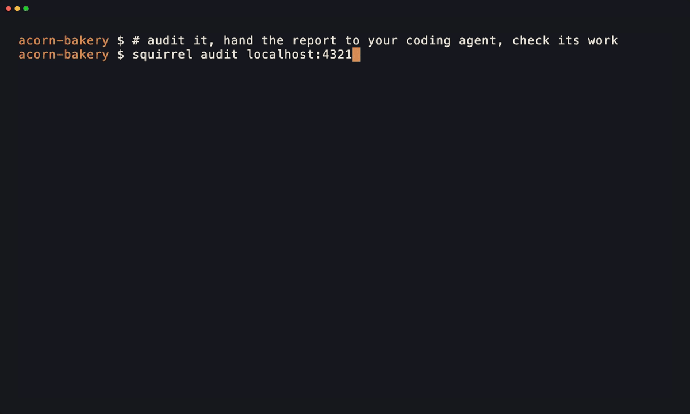

# squirrelscan

**The website QA tool for your coding agent**

squirrelscan is an Open Source cli tool that audits websites for SEO, performance, security, accessibility, agent experience and other issues, and gives your coding agent exact fixes. Run it from the CLI, inside your coding agent, in the cloud, or over MCP.

Combine your coding agent with a deterministic and extensible audit tool.

[](https://squirrelscan.com/add/cursor)
[](https://squirrelscan.com/add/claude)
[](https://squirrelscan.com/add/codex)
[](https://squirrelscan.com/add/opencode)
[](https://registry.modelcontextprotocol.io)

[](https://github.com/squirrelscan/squirrelscan/actions/workflows/ci.yml)
[](https://github.com/squirrelscan/squirrelscan/actions/workflows/codeql.yml)
[](https://www.npmjs.com/package/squirrelscan)
[](LICENSE)



<sub>A real run on a tiny test site, with the released CLI (signed out, so free) and Claude Code. We cut the two minutes the agent spent working, because nobody wants to watch an agent think.</sub>

## Features

- **[Built for coding agents](https://docs.squirrelscan.com/developers/agents)** - Skills for Claude Code, Cursor, Codex and any coding agent run the audit, fix and re-audit loop. Connect over the CLI, the hosted or local MCP server, or the API.
- **[Enriched fixes for you and your coding agent](https://docs.squirrelscan.com/guides/fix-your-site-with-an-ai-agent)** - Every finding says how to fix it, in LLM-optimized output your agent can apply, and every rule has its own docs page. Signed in, the report adds an editor's summary of what to fix first and the technology stack the site runs on.
- **[300+ rules, 22 categories](https://docs.squirrelscan.com/rules)** - Audit coverage across SEO, accessibility, performance, security, content and more.
- **[Agent experience](https://docs.squirrelscan.com/rules/ax)** - Audit how well AI agents can read, discover and act on your site: llms.txt, AGENTS.md, Markdown responses, and what AI crawlers are served.
- **[Link checking and monitoring](https://docs.squirrelscan.com/guides/link-checking)** - Perch, the cloud link checker, tells a broken link from a blocked one and confirms a failure before reporting it. On Pro and Team, scheduled audits email you when a link breaks.
- **[Security and site integrity](https://docs.squirrelscan.com/rules/integrity)** - Detect phishing kits, injected pages, leaked credentials and missing security headers.
- **[Entity map](https://docs.squirrelscan.com/guides/entity-map)** - Your site's JSON-LD collapsed into one graph: one identity, or a new one on every page.
- **[Browser rendering in the cloud](https://docs.squirrelscan.com/guides/browser-rendering)** - Signed in, pages are rendered in a real browser in the cloud, so single-page apps and JavaScript-heavy sites are audited as visitors see them, at no extra cost per page.
- **[Cloud audits](https://docs.squirrelscan.com/guides/cloud-audits)** - AI page analysis, scheduled audits, a per-website issue tracker and shareable reports.
- **[Smart crawling](https://docs.squirrelscan.com/crawl)** - Fast and memory efficient, incremental with ETag, Last-Modified and content hashing, and resumable from checkpoints.
- **[Crawl history and changes](https://docs.squirrelscan.com/cli/report)** - Track site evolution, compare crawls, spot regressions.
- **[Developer-first CLI](https://docs.squirrelscan.com/cli)** - Single binary, zero dependencies, shell completions, self-update.
- **[Multiple output formats](https://docs.squirrelscan.com/cli/report#output-formats)** - Console, JSON, HTML, Markdown, Text, LLM, XML.

## Rule categories

Ordered by how much a failure usually costs you, not by how many rules each one has.

| Category | Rules | What it covers |
|----------|-------|----------------|
| Crawlability | 20 | Whether search engines and agents can reach and index you at all: robots.txt, sitemap validity and coverage, indexability conflicts, redirect and canonical chains, soft 404s |
| Core SEO | 14 | The per-page fundamentals: title, meta description, H1, canonical, charset, doctype, robots meta, Open Graph and Twitter cards, plus canonical form drift across the site |
| Agent Experience | 17 | How ready you are for AI agents to read, discover and act on the site: whether GPTBot and Claude-User get the same content a browser does, AGENTS.md, llms.txt, Markdown responses, API and MCP discovery, licensing and noai signals, pay-per-crawl, response token weight |
| Site Integrity | 9 | Signs the site has been compromised: injected doorway pages, phishing kit signatures, obfuscated scripts, brand impersonation, cloaking, known-malicious URLs |
| Security | 22 | Transport and header hygiene: HTTPS and HSTS, CSP, cookie flags, mixed content, subresource integrity, leaked secrets, tokens in web storage, unprotected and downgraded forms, open GraphQL introspection and mutations over GET |
| Links | 13 | Internal and external link health: broken and dead links, in-page anchors whose target is gone, redirect chains, anchor-text quality, orphan and dead-end pages, pages linked only from sitewide chrome, HTTPS downgrades |
| Content | 25 | Text quality and honesty: common misspellings, duplicate titles and descriptions, title-template consistency, readability, word count, freshness, heading hierarchy, keyword stuffing, hidden text, placeholder media and contact details, encoding damage |
| Performance | 30 | Core Web Vitals and delivery: LCP, CLS and INP hints, TTFB, compression, caching, render-blocking resources, DOM size, font delivery, legacy and unminified JS/CSS |
| Reliability | 5 | Scripts, stylesheets and fonts that fail to load (a first-party bundle that answers 404 or 500 after a deploy, third-party and font failures), and forms that lose submissions |
| Images | 16 | Alt text, modern formats, responsive `srcset`, intrinsic dimensions and aspect-ratio mismatches, lazy loading above versus below the fold, file weight |
| Structured Data | 25 | JSON-LD validity and rich-result eligibility for Article, Product, FAQ, Review, Breadcrumb, Organization, LocalBusiness, Video and site search, plus thirteen site-wide checks on the entity map: whether the site declares one identity for itself or a new one on every page, and rating markup that is not about the page it sits on |
| Accessibility | 61 | WCAG coverage: ARIA roles and names, form labels and autocomplete tokens, colour contrast, heading order, landmarks, tables and lists, focus visibility, touch targets, captions |
| Mobile | 8 | Viewport configuration, tap-target size, legible font sizes, horizontal scroll, blocked zoom, form fields small enough to zoom the page on focus, intrusive interstitials, the web app manifest and its icons |
| Social Media | 5 | Open Graph and Twitter Card completeness, image dimensions, canonical URL match, social profile links, site-chrome assets that disagree across pages |
| URL Structure | 9 | Length, casing, hyphenation, stop words, query parameters, special characters, trailing-slash consistency, site-wide convention consistency |
| E-E-A-T | 15 | Experience, expertise, authority and trust signals: author bylines and credentials, about and contact pages, citations, editorial policy, disclaimers, YMYL detection |
| Legal Compliance | 4 | Privacy policy, terms of service, real cookie-consent machinery, subprocessor disclosure |
| Internationalization | 2 | hreflang correctness and the document language declaration |
| Local SEO | 3 | NAP (name, address, phone) consistency across every crawled page, geo metadata, service-area businesses |
| Video | 3 | VideoObject markup, captions and accessibility, thumbnails |
| Analytics | 2 | Google Tag Manager presence and consent-mode wiring |
| Blocking | 3 | Content, links and trackers that ad blockers and privacy filters strip for a large share of your visitors |

**Total: 300+ rules across 22 categories**

See the [rules reference](https://docs.squirrelscan.com/rules) for full details.

## CLI

### Installation

**Paste into your coding agent** (Claude Code, Codex, Cursor, opencode and friends):
```text
Fetch and follow the setup instructions for squirrelscan at https://docs.squirrelscan.com/agent-setup/prompt.md
```
Your agent installs the CLI, connects MCP and runs a first audit. You can [read exactly what it will follow](https://docs.squirrelscan.com/agent-setup/prompt) first.

**macOS / Linux:**
```bash
curl -fsSL https://install.squirrelscan.com | bash
```

**Windows:**
```powershell
iwr -useb https://install.squirrelscan.com/install.ps1 | iex
```

**Homebrew (macOS):**
```bash
brew install --cask squirrelscan/tap/squirrel
```
The cask installs a launcher that runs the regular installer on first use. The CLI then updates itself with `squirrel self update`; `brew upgrade` leaves it alone.

**npm (all platforms):**
```bash
npm install -g squirrelscan
```

**npx (run without installing):**
```bash
npx squirrelscan audit example.com
```

### Quick start

```bash
# Audit a website
squirrel audit example.com

# Generate HTML report
squirrel audit example.com -f html -o report.html

# Pipe to Claude for AI analysis
squirrel audit example.com --format llm | claude

# Quick audit for a fast first look (other levels: surface, full)
squirrel audit example.com --level quick

# run only agent experience and performance rules
squirrel audit example.com --rule-include ax,performance

# login for cloud audits and cloud rendering
squirrel auth login
```

## Reports

A health score and grade, group scores for SEO, performance, security and Agent Experience (AX) colored by score, a ranked list of issues, and a copy fix prompt for each one that you can paste into your coding agent. Publish reports to the web to share with team members or coding agents (fix instructions are embedded).


[See an example report](https://reports.squirrelscan.com/01M5NJH51Q6FNRAA3QGW8GYWB6), or read [how to read your report](https://docs.squirrelscan.com/guides/read-your-report).

## Add to your coding agent

squirrelscan ships as an **MCP server** (hosted at `mcp.squirrelscan.com`), **skills** (autonomous audit + fix workflows), and a **plugin** for Claude Code and Cursor. Cursor installs in one click from the badge above; the rest are a single copy-paste.

### Cursor

Click the **Add to Cursor** badge above, or add it manually to `~/.cursor/mcp.json`:

```json
{
  "mcpServers": {
    "squirrelscan": { "url": "https://mcp.squirrelscan.com/mcp" }
  }
}
```

Skills: `squirrel skills install`

### Claude Code

Install the plugin (bundles skills + the MCP server):

```
/plugin marketplace add squirrelscan/skills
/plugin install squirrelscan@squirrelscan
```

Or add just the MCP server:

```bash
claude mcp add --transport http squirrelscan https://mcp.squirrelscan.com/mcp
```

### OpenAI Codex

Add the server to `~/.codex/config.toml`:

```toml
[mcp_servers.squirrelscan]
url = "https://mcp.squirrelscan.com/mcp"
```

Codex reads Agent Skills from `~/.agents/skills`, so skills work too: `squirrel skills install`

### opencode

Add the server to `opencode.json`:

```json
{
  "$schema": "https://opencode.ai/config.json",
  "mcp": {
    "squirrelscan": {
      "type": "remote",
      "url": "https://mcp.squirrelscan.com/mcp",
      "enabled": true
    }
  }
}
```

### Any MCP client

squirrelscan is in the [MCP Registry](https://registry.modelcontextprotocol.io) as `com.squirrelscan/squirrelscan`. Point any client at the remote server:

```
https://mcp.squirrelscan.com/mcp
```

Authentication is per-user OAuth (or pass a squirrelscan API key as a Bearer token). Skills follow the [Agent Skills standard](https://agentskills.io): `squirrel skills install` puts them in `~/.agents/skills/` and `~/.claude/skills/`.


## Skills

Two skills drive agent workflows. They live in [squirrelscan/skills](https://github.com/squirrelscan/skills), along with the Claude Code, Cursor and Agent Plugins packages that bundle them with the MCP server. `squirrel skills install` downloads and verifies them itself, and from v0.0.99 `squirrel`'s auto-update keeps them current. Installs made earlier with `npx skills` are taken over.

- **`squirrelscan`** - operating the CLI: install, login, keys, credits, running audits, publishing reports, the entity map, MCP setup, config, troubleshooting.
- **`audit-website`** - the full fix loop: audit, map issues to source files, fix in batches, re-audit until the site scores well.

```bash
squirrel skills install
```

Then, in your agent:

```
Use the audit-website skill to audit this site and fix all issues but only crawl 10 pages
```

## Output formats

| Format | Flag | Use Case |
|--------|------|----------|
| Console | (default) | Human-readable terminal output |
| JSON | `-f json` | CI/CD, programmatic processing |
| HTML | `-f html` | Visual reports for sharing |
| Markdown | `-f markdown` | Documentation, GitHub |
| Text | `-f text` | Clean output for piping to LLMs |
| LLM | `-f llm` | LLM optimized output |
| XML | `-f xml` | XML output |

## Source and development

The complete local CLI, crawler, audit engine, rules, report generators, CLI-facing cloud clients, and documentation site are open source in this repository. The hosted API, website, dashboard, and cloud worker implementations are separate private services.

Prerequisites: [Bun 1.4.4](https://bun.sh/) and Git.

```bash
git clone https://github.com/squirrelscan/squirrelscan.git
cd squirrelscan
bun install --frozen-lockfile
bun run dev -- audit https://example.com --max-pages 10
```

Run the same checks used in pull requests:

```bash
bun run format:check
bun run lint
bun run typecheck
bun test
bun run build
bun run docs:check
bun run docs:build
```

See [CONTRIBUTING.md](CONTRIBUTING.md) before opening a pull request. Contributions require a Developer Certificate of Origin sign-off (`git commit -s`).

## Telemetry

Telemetry is enabled by default and is deliberately minimal: event name, CLI version, a random install ID, and bounded error categories. It does not send credentials, URLs, report contents, or raw error messages, and telemetry requests are never authenticated.

Disable it permanently with:

```bash
squirrel self settings set telemetry false
```

Or disable all telemetry and install registration for any invocation by defining `NO_TELEMETRY`. Any defined value works, including an empty value, `0`, or `false`:

```bash
NO_TELEMETRY=1 squirrel audit https://example.com
```

## Links

- [Website](https://squirrelscan.com)
- [Documentation](https://docs.squirrelscan.com)
- [FAQ](https://docs.squirrelscan.com/faq)
- [Coding agent integration](https://docs.squirrelscan.com/agents)
- [Share feedback](https://squirrelscan.com/feedback)
- [Bugs, issues and feature requests](https://github.com/squirrelscan/squirrelscan/issues)
- [Twitter/X](https://x.com/squirrelscan_)

If squirrelscan caught something your agent missed, a [star on GitHub](https://github.com/squirrelscan/squirrelscan) helps other developers find it.

## License

The CLI and the repository contents are licensed under the [MIT License](LICENSE). squirrelscan names and logos are covered by [TRADEMARKS.md](TRADEMARKS.md).
